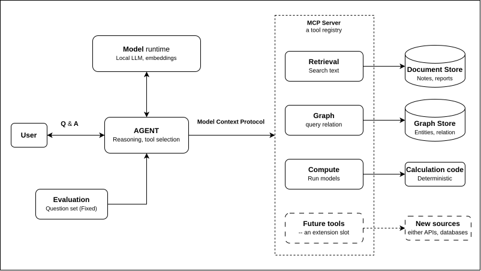

# Home Energy Agent

### Home Energy Planning Agent a PoC

For planning residential energy systems, this acts as Local-first LLM agent.
Example:- rooftop PV, battery storage, heat pump.


Retrieval, a knowledge graph and a calculation tool are exposed through a Model Context Protocol (MCP) server.
Later a LangGraph agent running on Ollama discovers and calls the tools.

## Architecture




## File structure of the Project

| Box | Current implementation |
|---|---|
| Agent | LangChain / LangGraph agent (`agent.py`) |
| Model runtime | Ollama (chat model & embedding model) |
| MCP server | FastMCP over stdio (`mcp_server.py`) |
| Retrieval, document store | ChromaDB over markdown notes in `data/knowledge/` |
| Graph, graph store | rdflib graph (`data/kg.ttl`), SPARQL & name-resolving lookups |
| Compute, calculation code | Simplified PV yield function |
| Evaluation | `evaluate.py` |

If one is interested in understanding on design of mcp, go-through `mcp_server.py` for the current tool list and [MCP_NOTES.md](docs/MCP_NOTES.md) for notes.

## Run
    pip install -r requirements.txt
    ollama pull qwen2.5:3b && ollama pull nomic-embed-text
    export LLM_MODEL=qwen2.5:3b
    python agent.py

Offline smoke test of retrieval without Ollama: `EMBED_BACKEND=hash`.

## Evaluation

```bash
python evaluate.py
```

The script sends a small fixed set of questions to the agent. For each one it checks that the expected tool was called and that the answer contains (or avoids) certain terms, then writes `results/results.md`. These are simple automatic checks, not a benchmark.


## Key Information
- Data in `data/` is illustrative placeholder content and the yield model is a simplification, not a design tool.

- A small local model (3B parameters) on CPU is slow and can over-generalize from correct tool results. This is the reason the evaluation script exists.

- As this is a PoC, further possbile steps:-
        -- The evaluation set (to add it with better context based) is small and its checks are keyword based.
        
        -- To ingest real documents, because the knowledge graph is small and written by hand.

        -- Probably, might additional tools.

